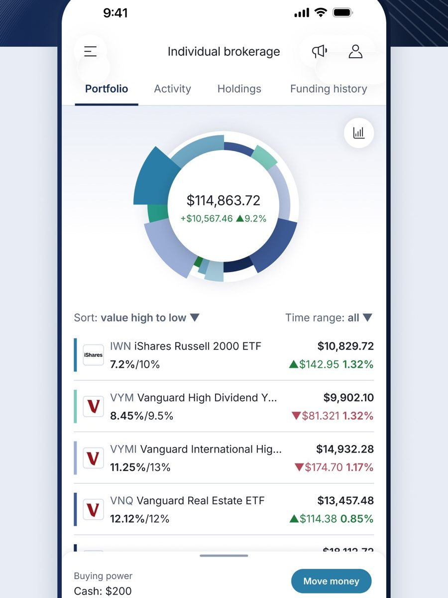
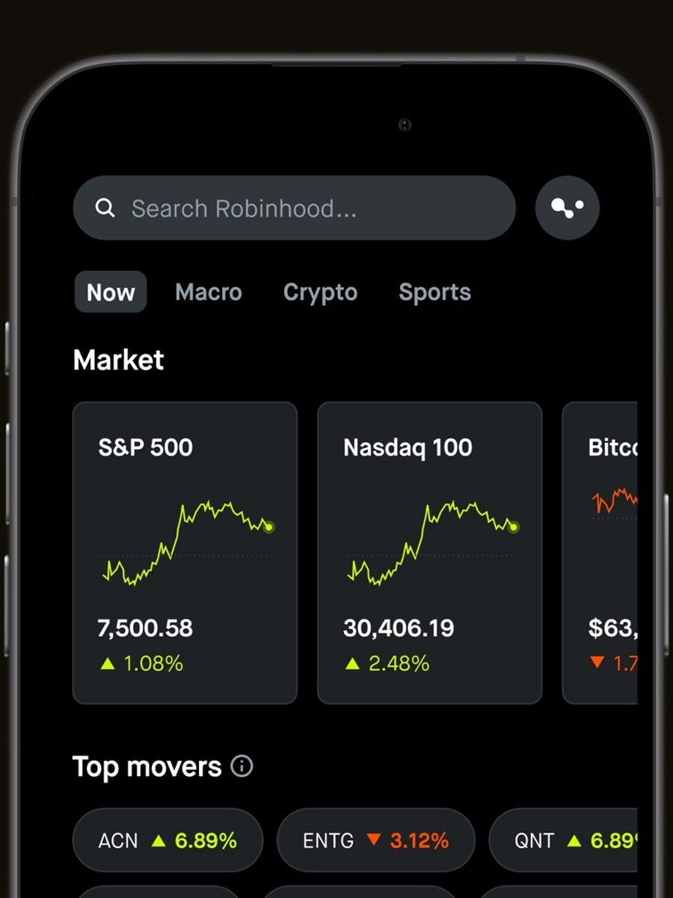
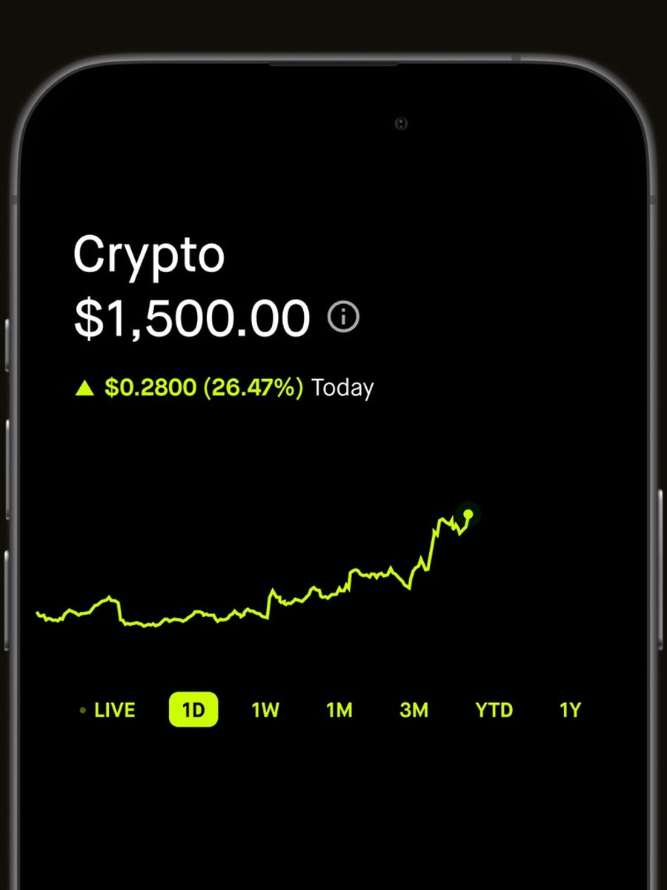
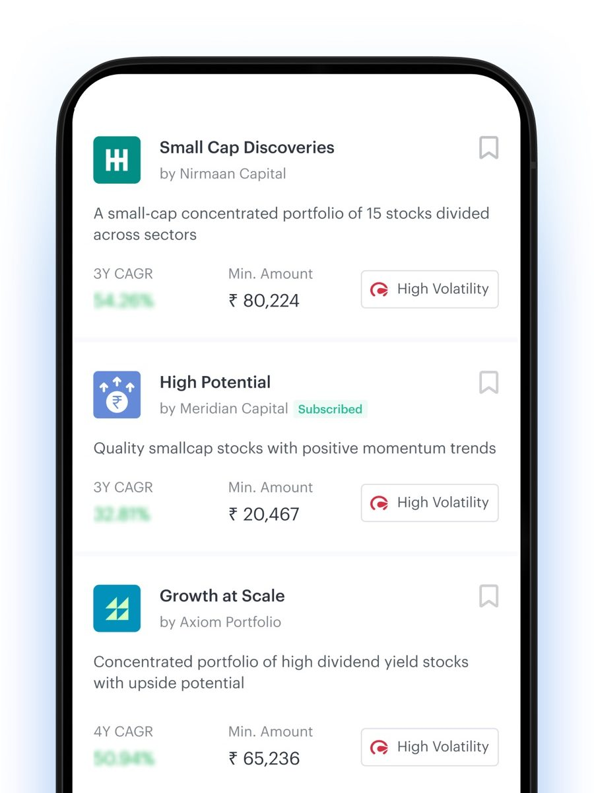
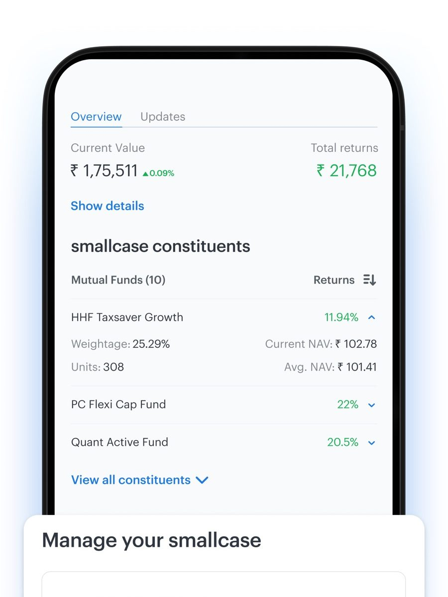
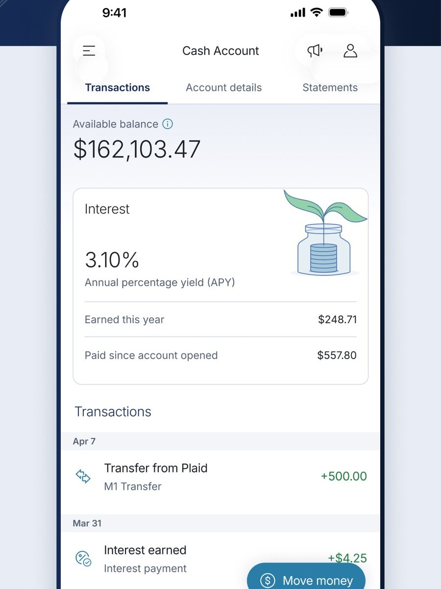
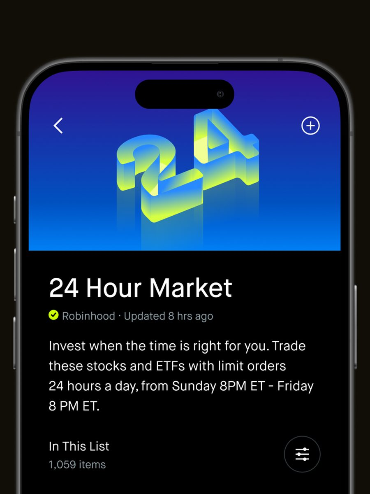
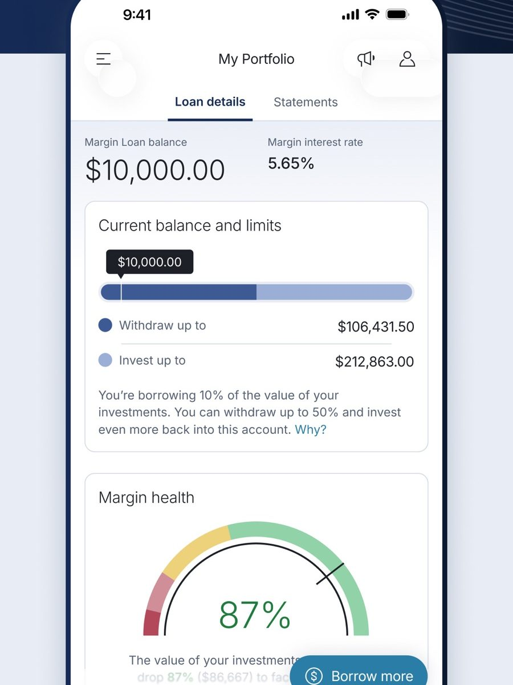

# 07 · Design

## Principle

Built for investors, not traders. Every screen should make doing nothing feel fine and doing
something feel considered. No streaks pushing trades, no leaderboard of who gambled hardest.

## The visual language, and where it comes from

We take it from **Phantom and Robinhood**, deliberately and closely. Both have spent years
teaching millions of people what an on-chain money app looks like, and fighting that is a cost
with no return.

|              |                                                                                                                                                             |
| ------------ | ----------------------------------------------------------------------------------------------------------------------------------------------------------- |
| **Ground**   | True black. Not a tinted near-black, not a slate                                                                                                            |
| **Type**     | One sans, Geist, at 400 to 700. Figures are the same face, set heavy and tabular. No serif anywhere                                                         |
| **Rows**     | Filled rounded cards with a gap between them and a circular tinted icon, the way Phantom lists tokens. Not a flat list on dividers                          |
| **Headings** | Readable bold text at 17px, not micro uppercase                                                                                                             |
| **Colour**   | One green carries both the brand and a gain, which is Robinhood's move and one colour fewer to manage. Red for a loss. Amber only for the market being shut |
| **Charts**   | A single line with a soft fill, drawn once on mount. No axes, grid or crosshair                                                                             |

The implementation lives in `apps/web/src/tokens.css` and `apps/web/src/ui/primitives.tsx`.

Reference sheets are in `docs/refs` and `docs/refs/crypto`.

| Reference                                          | What we take                                                                                                                                                                                        |
| -------------------------------------------------- | --------------------------------------------------------------------------------------------------------------------------------------------------------------------------------------------------- |
|                   | **M1 · portfolio.** One value, a ring, then holdings. Five tabs at the bottom; we use four                                                                                                          |
|     | **Robinhood · discovery.** Search, a few index tiles, then top movers. Three shelves is enough                                                                                                      |
|  | **Robinhood · asset page.** Price, change, chart, timeframe pills, nothing else above the fold. Our issuer comparison goes directly below                                                           |
|    | **smallcase · baskets.** Publisher, past return, minimum, risk badge. The shape of our basket list                                                                                                  |
|      | **smallcase · recurring.** An active plan with its next date, editable in one tap                                                                                                                   |
|                        | **M1 · cash.** A rate, interest earned this year, and the payments that produced it                                                                                                                 |
|          | **Robinhood · 24 Hour Market.** Limit orders only, Sunday 8pm to Friday 8pm. They close for the weekend because the risk is real. Our tokens trade through it, which is why the premium gate exists |
|                   | **M1 · borrowing.** Balance, rate, headroom and a health gauge with a plain sentence. Version two, plus a Monday gap number                                                                         |

Screenshots are from public App Store listings and belong to their owners. Design reference only.

## Screens

### Home

`Portfolio value` → `change` → `sparkline` → `holdings list` → `exposure callout`.

Holdings rows carry ticker, company, share count, value, day change. A wrapper-count badge
appears when a position spans more than one issuer, and tapping it opens the exposure sheet.

### Exposure sheet

Total shares and value, then one row per wrapper with issuer, share count, percentage and
multiplier. A short explanation at the bottom of why the screen exists, because most users will
not know that two tokens for the same stock are different things.

### Stock page

`price` → `chart` → `timeframe pills` → `about` → `issuer comparison` → `Buy` / `Sell`.

The issuer comparison is the signature screen. Both wrappers, each with price per share and price
impact, one marked best and one marked avoided with a reason. It regenerates when the amount
changes, because the answer depends on size.

### Buy sheet

Amount input with quick chips at $25, $100, $500. Then estimated shares, price per share, the
issuer chosen, the premium against the real share price, and the fee. One primary button.

Three terminal states, all designed:

- **Filled.** Share count, the issuer used, a link to the transaction.
- **Queued.** Why we waited, the trigger price, and when the market opens. A clear note that the
  order fills on chain without the app being open.
- **Refused.** Which issuers were tried, what was wrong with each, and a suggestion.

### Market-closed banner

Persistent across Invest while the US market is shut. Session, when it reopens, and a line
saying prices can drift while it is closed. Amber, not red. It is a fact, not an error.

### Basket page

Name, performance, fee, minimum. Constituents with weight bars. One amount input. A line under
the button reading _"Buys all six. Held afterwards as one position."_

### Money

Balance, the rate it earns, interest earned this year. Receive and Send rows. Then a borrowing
card, visibly switched off, showing what the current portfolio would support.

### Activity

Grouped by day. Each row has an icon, a title, a subtitle and an amount. Expanding shows the
detail and the signature.

## States that must exist before we call anything done

Empty, loading, error and offline for every list. Plus these, which are specific to us:

| State                                        | Where                         |
| -------------------------------------------- | ----------------------------- |
| Market closed                                | Invest, stock page, buy sheet |
| Instrument halted for a corporate action     | Stock page, buy sheet         |
| Only one issuer routable                     | Stock page comparison         |
| No issuer routable at this size              | Buy sheet                     |
| Reference price stale                        | Buy sheet, blocks the order   |
| Queued order waiting                         | Home, Activity, stock page    |
| Dividend recognised                          | Home, Activity                |
| Estimated cost basis on a transferred-in lot | Holding row, exposure sheet   |

## Tokens

Shared names across Tailwind and NativeWind so the two apps stay in step.

```
bg, surface, surfaceRaised, border
text, textMuted, textFaint
accent            single blue, used for primary actions only
positive, negative
warning           amber, used for market-closed and premium states
```

Type scale 12 / 14 / 16 / 20 / 28 / 40. Radius 12 for cards, 16 for sheets, 26 for buttons.
Spacing on a 4pt grid. One accent colour. Numbers in a tabular figure face so columns line up.

## Platform split

| Surface          | Purpose                 | Notes                                                |
| ---------------- | ----------------------- | ---------------------------------------------------- |
| iOS, Expo        | The product             | What the demo video shows                            |
| Web, Vite        | The build judges open   | Same features. No install, no TestFlight, no QR code |
| Landing, Next.js | Marketing and the pitch | Also hosts the shareable read-only portfolio page    |

Judges will not install Expo Go to evaluate a submission. The web build is not a compromise, it
is the entry.
